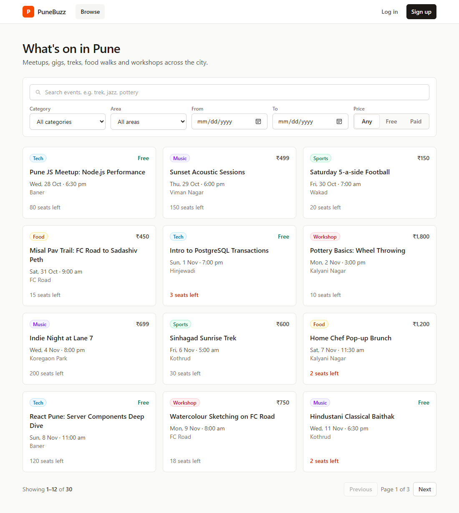
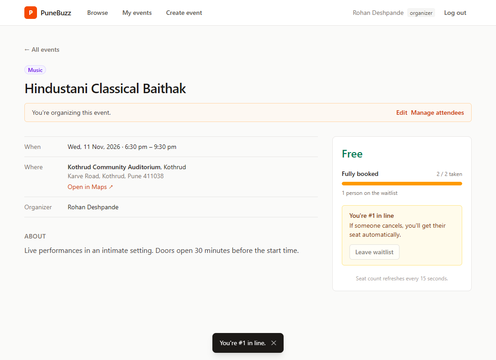
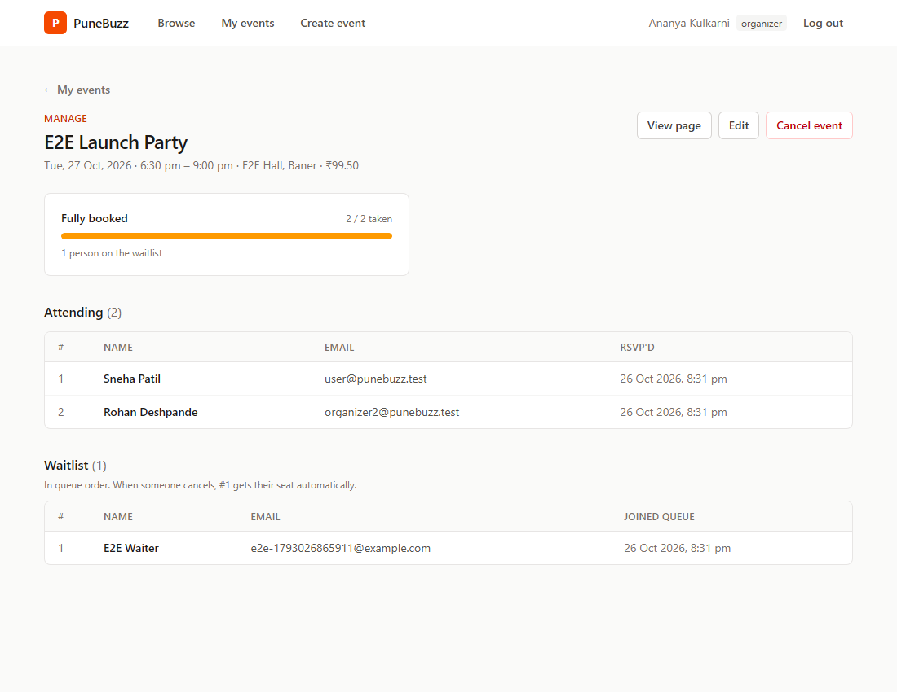
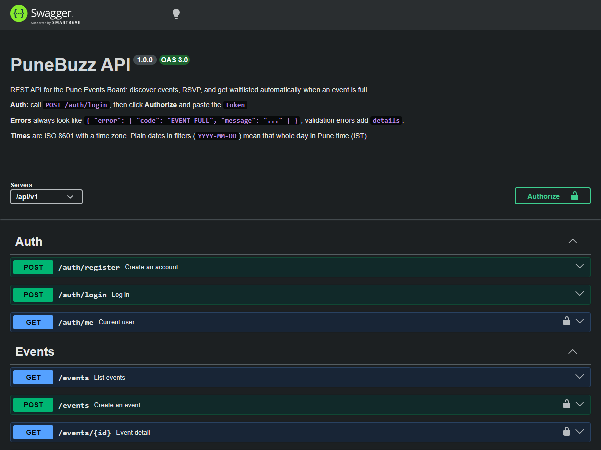
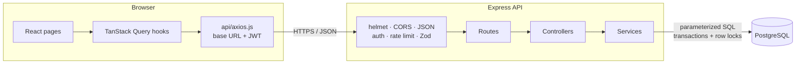

# PuneBuzz: Pune Events Board

Find events across Pune, RSVP in one click, and land on the waitlist automatically when an event is full. When someone cancels, the first person in line gets their seat.

The interesting part is seat allocation that stays correct when many people click RSVP for the last seat at the same moment. [How that works](#the-concurrency-problem) is explained below, along with the test that proves it.



| Event page (waitlisted) | Organizer view | API docs |
| --- | --- | --- |
|  |  |  |

## Features

- **Browse:** filter by category, area, date range and free/paid, plus full-text search. Filters live in the URL, so a filtered list can be shared.
- **RSVP:** live seat count (refreshes every 15 s) and optimistic UI that rolls back if the server says no. You're waitlisted automatically when full ("You're #3 in line") and promoted automatically when a seat frees up.
- **My events:** what you're attending, waitlisted for, and organizing.
- **Organizers:** create and edit events (with inline venue creation), see attendees and the waitlist in order, cancel an event.
- **Security:** JWT auth with bcrypt, role checks, helmet headers, rate limits on login, sign-up and RSVP, and parameterized SQL only.

## Stack

| Layer | Choice |
| --- | --- |
| Frontend | React 19 + Vite, React Router, TanStack Query, Axios, Tailwind CSS |
| Backend | Node.js 22 + Express 5, plain JavaScript (CommonJS) |
| Database | PostgreSQL 16 via `pg`, with **raw SQL and no ORM** |
| Validation | Zod |
| Auth | JWT (7-day) + bcrypt |
| Tests | Jest + Supertest against a real Postgres |
| Docs | OpenAPI 3 + Swagger UI at `/api/docs` |
| Deploy | Render (API + Postgres), Vercel (client) |

## Getting started

You need Node 22 and Docker.

```bash
git clone <this repo> && cd PuneBuzz

# 1. Database: Postgres 16 in Docker, data in a named volume
docker compose up -d --wait

# 2. API
cd server
cp .env.example .env          # defaults match docker-compose.yml; change JWT_SECRET
npm install
npm run migrate               # creates the tables
npm run seed                  # 3 test users, 10 venues, 30 events (WIPES existing data)
npm run dev                   # http://localhost:4000/api/v1, docs at http://localhost:4000/api/docs

# 3. Client (new terminal)
cd client
cp .env.example .env          # VITE_API_URL=http://localhost:4000/api/v1
npm install
npm run dev                   # http://localhost:5173
```

The seed prints these test accounts:

| Role | Email | Password |
| --- | --- | --- |
| organizer | `organizer1@punebuzz.test` | `Organizer1!pass` |
| organizer | `organizer2@punebuzz.test` | `Organizer2!pass` |
| user | `user@punebuzz.test` | `User1!password` |

Five seeded events have capacity 2 or 3. RSVP to one with all three accounts and the third lands on the waitlist.

### Tests

```bash
cd server
npm test        # 135 tests, including the concurrency test; needs Postgres running
```

Tests run against a separate `pune_events_test` database. It's created and migrated automatically, and the tests refuse to run against any database whose name doesn't end in `_test`.

## Architecture



The backend is layered **routes → controllers → services → db**, and each layer only talks to the one below it:

- **Routes** declare the path and its middleware (`auth`, `requireRole`, rate limits, `validate(zodSchema)`).
- **Controllers** read the validated request, call one service function, and pick the status code.
- **Services** hold the business rules and **all of the SQL**. They never see `req` or `res`, and they throw `AppError(status, code, message)` for expected failures.
- **One error handler** turns every error into the same shape: `{ "error": { "code": "EVENT_FULL", "message": "…" } }`. Unexpected errors become a generic 500, and stack traces and SQL never reach the client.

```text
server/src/
  app.js, server.js        express app / HTTP server
  config/env.js            env vars, validated with Zod at startup
  db/                      pool, migrator, migrations/*.sql, seed
  routes/ controllers/ services/ validators/ middleware/
  docs/openapi.js          the API spec served at /api/docs
client/src/
  api/                     axios instance + one module per resource
  hooks/                   TanStack Query hooks (useEvents, useEvent, useRsvp, ...)
  components/ pages/ context/AuthContext.jsx utils/
```

`CLAUDE.md` has the full coding conventions.

## API

Every route is under `/api/v1`. The full interactive reference is at **`/api/docs`**, with the raw spec at `/api/docs.json`. A test fails if any route is missing from it.

| Method | Path | Who | What |
| --- | --- | --- | --- |
| POST | `/auth/register` | Public | Create an account (`role`: `user` or `organizer`) → `{ user, token }` |
| POST | `/auth/login` | Public | Log in → `{ user, token }` |
| GET | `/auth/me` | User | Current user |
| GET | `/events` | Public | List: `category`, `area`, `from`, `to`, `q`, `free`, `page`, `limit` → `{ data, page, limit, total }` |
| GET | `/events/:id` | Public | Detail with `seatsLeft`, `waitlistCount`, and `myStatus` when logged in |
| POST | `/events` | Organizer | Create |
| PATCH | `/events/:id` | Owner | Edit; capacity can't drop below seats taken |
| DELETE | `/events/:id` | Owner | Cancel (soft delete; history kept) |
| POST | `/events/:id/rsvp` | User | `{ status: "confirmed" }` or `{ status: "waitlisted", position }` |
| DELETE | `/events/:id/rsvp` | User | Cancel your seat (promotes waitlist #1) or leave the waitlist |
| GET | `/events/:id/attendees` | Owner | Confirmed list + waitlist in order |
| GET | `/me/events` | User | `{ attending, waitlisted, organizing }` |
| GET | `/venues` | Public | All venues |
| POST | `/venues` | Organizer | Add a venue |
| GET | `/health` | Public | API + database check |

"Owner" means the event's organizer or an admin.

Status codes: 201 for create, 400 validation, 401 no or bad token, 403 not allowed, 404 missing, 409 conflict (already joined, event closed, capacity below seats taken), 429 rate limited.

**Rate limits** (in memory, per API instance):

- Failed logins: 10 per IP per 15 minutes.
- Sign-ups: 10 per IP per hour.
- RSVP and cancel combined: 20 per user per 10 minutes.

## The concurrency problem

An event has `capacity` and a `seats_taken` counter. The obvious RSVP code is:

```sql
SELECT capacity, seats_taken FROM events WHERE id = $1;   -- 4 of 5 taken: a seat is free
INSERT INTO rsvps (event_id, user_id) VALUES ($1, $2);
UPDATE events SET seats_taken = seats_taken + 1 WHERE id = $1;
```

Run on its own, that's correct. Two people clicking at the same moment for the **last** seat is a different story:

```text
time   Request A                          Request B
 1     SELECT → 4 of 5 taken, seat free
 2                                        SELECT → 4 of 5 taken, seat free   ← stale
 3     INSERT rsvp, seats_taken = 5
 4                                        INSERT rsvp, seats_taken = 6        ← overbooked
```

Both requests read the same "4 of 5" before either one wrote, so both confirm. This is a classic *check-then-act* race. Wrapping the steps in a transaction doesn't fix it on its own: under Postgres's default `READ COMMITTED` isolation, B's `SELECT` doesn't wait for A.

### The fix: lock the event row

Every RSVP and cancellation (`server/src/services/rsvp.service.js`) runs in one transaction that starts by locking the event's row:

```sql
BEGIN;
SELECT id, capacity, seats_taken, status, starts_at
  FROM events WHERE id = $1
  FOR UPDATE;                 -- B waits here until A commits
-- reject if closed / already joined
-- seat free?  INSERT INTO rsvps ...;  UPDATE events SET seats_taken = seats_taken + 1 ...
-- otherwise   INSERT INTO waitlist ...; position = queue length
COMMIT;
```

`FOR UPDATE` takes a row-level lock. A second transaction that tries to lock the same row **blocks** until the first commits, then reads the *new* `seats_taken`:

```text
time   Request A                          Request B
 1     SELECT ... FOR UPDATE → 4 of 5
 2                                        SELECT ... FOR UPDATE → waits
 3     INSERT rsvp, seats_taken = 5, COMMIT
 4                                        → now reads 5 of 5: full → waitlisted, position 1
```

Requests for the *same* event queue up one at a time, while requests for *different* events never block each other, because only one row is locked. Keeping `seats_taken` on the event row is what makes this cheap: the check is a single-row lock, not a `COUNT(*)` over all RSVPs.

Cancelling takes the same lock. If you give up a confirmed seat and someone is waiting, the oldest waitlist entry moves straight into `rsvps` in the same transaction, so `seats_taken` never changes and the seat can't be grabbed by a newcomer in between. Organizer edits (capacity changes) and event cancellation lock the row too.

### Defence in depth

```sql
CHECK (seats_taken BETWEEN 0 AND capacity)
```

Even if application code had a bug, the database refuses to overbook. `UNIQUE (event_id, user_id)` on `rsvps` and `waitlist` stops a double-click from joining twice.

### Proving it

`server/tests/rsvp.concurrency.test.js` creates an event with capacity 5 and fires **20 RSVPs from 20 users at once** (`Promise.all` against a real HTTP server and a real Postgres). It asserts:

- exactly **5 confirmed** and **15 waitlisted**, with positions 1 to 15 and no duplicates;
- `seats_taken = 5`, 5 rows in `rsvps`, and 15 in `waitlist`;
- cancelling a confirmed seat promotes waitlist #1, and #2 becomes #1;
- all 5 confirmed users cancelling at once promotes the 5 oldest waitlisted users, in order;
- a triple-clicked RSVP from one user succeeds once (two 409s);
- under mixed concurrent RSVPs and cancels, `seats_taken` always equals the number of RSVP rows.

**Removing `FOR UPDATE` makes it fail.** In our run, 5 of the 20 requests returned 500. Several requests read the same stale count and tried to confirm, and the `CHECK` constraint rejected the overbooking. The database caught the bug, but users saw errors instead of waitlist spots. With the lock, all 20 succeed.

### A second, subtler race: queue order

The waitlist is ordered by `created_at`. The original schema used `DEFAULT now()`, but in Postgres `now()` is the time the **transaction started**, not when the row was written. Twenty concurrent requests *start* in one order but *acquire the lock* in another, so the stored order could disagree with the position each person was told. "You're #1" might not be the one promoted. A test caught this intermittently: it failed **8 times out of 15**.

Migration `002_queue_order.sql` switches the default to `clock_timestamp()`, the actual insert time. Inserts happen while the lock is held, so the timestamp follows lock order (with `id` as a tie-breaker). After the fix the test passed **15 out of 15**.

### Alternatives considered

- **Atomic conditional update:** `UPDATE events SET seats_taken = seats_taken + 1 WHERE id = $1 AND seats_taken < capacity` is enough to *claim a seat*. But the flow also needs a duplicate check and a waitlist insert with a position, and all of these must agree with each other. One lock over the whole flow is simpler to reason about.
- **`SERIALIZABLE` isolation:** also correct, but conflicting transactions abort and must be retried in application code. Row locks make them wait instead.
- **Counting RSVPs instead of keeping a counter:** you'd need to lock or serialize on something anyway, and every check becomes a `COUNT(*)`.

## Deployment

The API and Postgres go on Render (`render.yaml` Blueprint) and the client on Vercel (`client/vercel.json`). The step-by-step guide, including environment variables, CORS and a post-deploy checklist, is in **[docs/DEPLOYMENT.md](docs/DEPLOYMENT.md)**.

## Known limitations

- **Rate limits are kept in memory,** so they're per instance and reset on restart. Use a shared store (e.g. Redis) before scaling out.
- **Live updates come from polling every 15 s,** not WebSockets.
- **No email notifications** (e.g. "you got a seat") and **no payments.** Paid events show a price, and payment happens at the venue.
- **Anyone can sign up as an organizer,** with no approval step. Admins can only be created in the database. There's also no way to switch account type after signing up.
